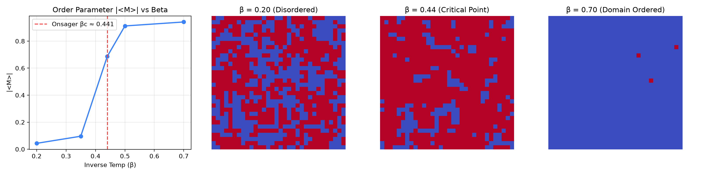
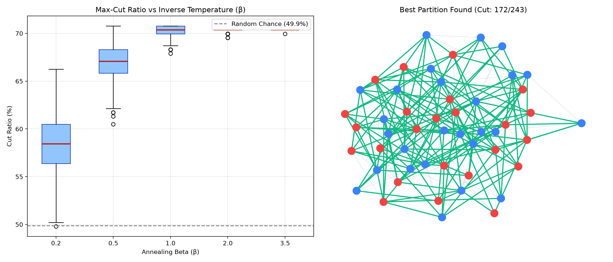
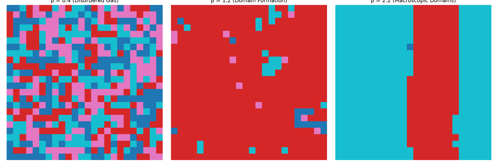
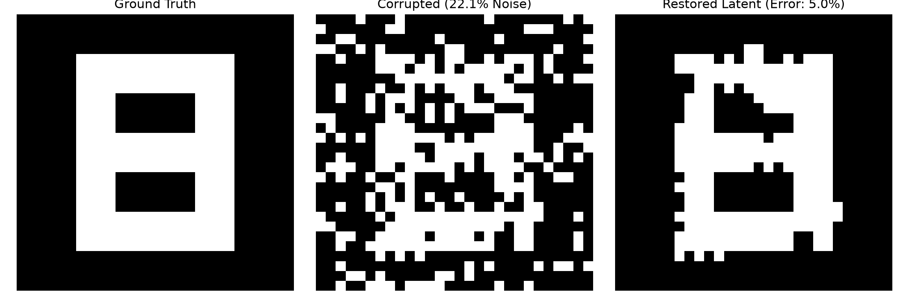
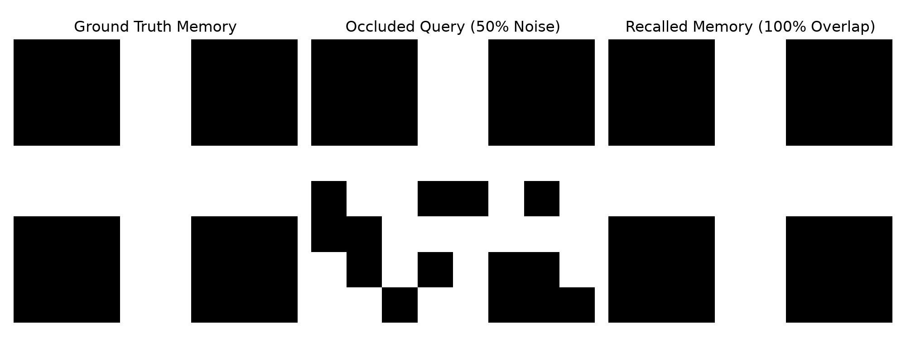
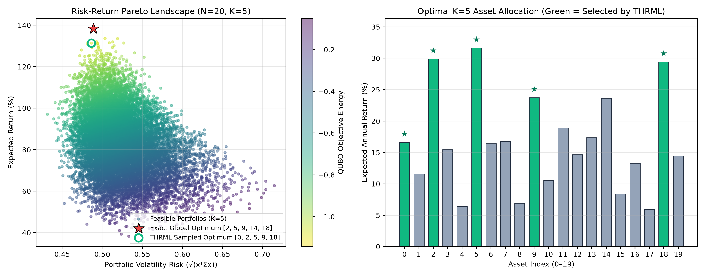
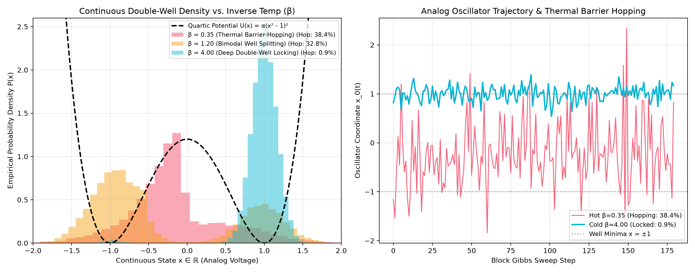
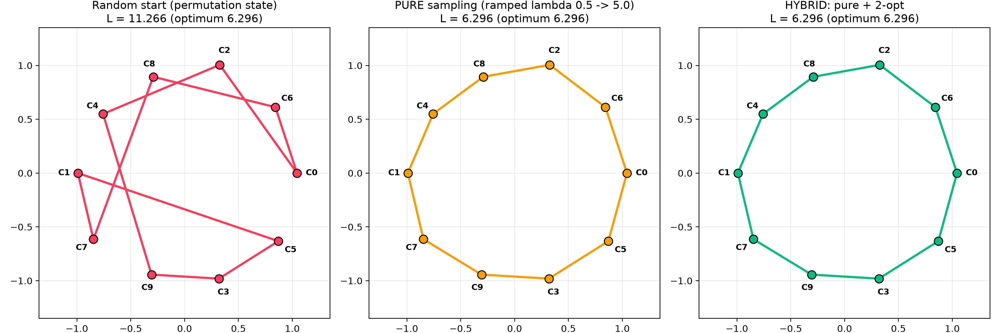
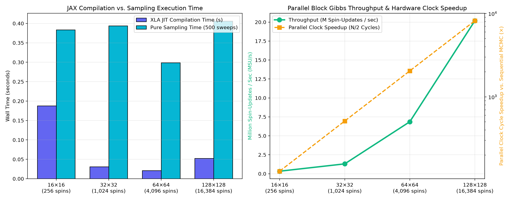

# Thermodynamic Computing Reference Implementations & Reproducibility Suite

[](https://github.com/nexusai-kevin/thermo-physics/actions/workflows/ci.yml)
[](https://colab.research.google.com/github/nexusai-kevin/thermo-physics/blob/main/notebooks/quickstart_tutorial.ipynb)
[](https://github.com/extropic-ai/thrml)
[](https://github.com/jax-ml/jax)
[](#4-reproducibility-benchmark-results-native-thrml)
[](#4-reproducibility-benchmark-results-native-thrml)
[](#5-visual-proof-2d-lattice-dtm-denoising-output)
[](#6-quickstart-usage)
[](LICENSE)

A modular reference implementation and hardware-aware reproducibility benchmark suite for **Energy-Based Models (EBMs)**, **Factor Graphs**, **Multi-Color Block Gibbs Sampling**, and **Denoising Thermodynamic Models (DTMs)** executing on Extropic's [`thrml`](https://github.com/extropic-ai/thrml) and JAX stack.

---

## Key Verified Highlights (Native `thrml` v0.1.4)

| Core Verification Metric | Measured Result | Physical Meaning |
| :--- | :--- | :--- |
| **Boltzmann Equilibrium** | `TV Distance = 0.0484` (`KL = 0.01089`) | Empirical Block Gibbs distribution converges to exact brute-force $P(s) = e^{-\beta E(s)} / Z$ |
| **Exact vs. Empirical Energy** | `Exact <E> = -1.7699` vs. `Empirical <E> = -1.7685` | Absolute energy error $\|\Delta E\| = 0.0014$ across 12,000 samples on a frustrated $2 \times 4$ spin lattice |
| **Hardware Parallel Speedup** | `18.0x per sweep` (`22.4x per independent sample`) | 2-Color Checkerboard Block Gibbs updates in **2 clock cycles/sweep** vs. **36 cycles** for sequential MCMC |
| **DTM Energy Relaxation** | `-87.74 -> -96.56` (`75.0% -> 81.9%` pixel accuracy) | Physical thermal annealing repairs spin-flip corruption in **72.0x** fewer clock cycles than single-site MCMC |
| **Projected TSU Energy Efficiency** | `104.17 fJ / spin-update` (`1.55e+10x` reduction) | Subthreshold CMOS p-bit array (~1W) vs. measured 300W GPU tensor/MCMC execution (`154.93 mJ/sweep`) |

---

## 1. Architectural Overview: Deterministic Layers vs. Energy Landscapes

| Paradigm | State Representation | Forward / Inference Mechanism | Hardware Primitive |
| :--- | :--- | :--- | :--- |
| **Classical Neural Network** | Deterministic activations $x \in \mathbb{R}^n$ | Matrix-vector multiply $y = f(Wx + b)$ | GPU Tensor Core (MAC arrays, 200–400W) |
| **Thermodynamic EBM (`thrml`)** | Stochastic spin states $s_i \in \{-1, +1\}$ | Physical thermal relaxation $P(s) = \frac{1}{Z} e^{-\beta E(s; \theta)}$ | Thermodynamic Sampling Unit (p-bit CMOS subthreshold arrays, ~1W) |

### Graph Coloring & Parallel Block Gibbs
To sample from the Boltzmann distribution $P(s) = \frac{1}{Z(\theta)} e^{-\beta E(s; \theta)}$ in parallel without violating detailed balance, the factor graph is partitioned into **independent sets (`Block`s)** where no two nodes in the same `Block` share an edge:
- **Bipartite V-H-L Classifier (Project A):** Visible ($V$) and Label ($L$) nodes connect only to Hidden ($H$) nodes, enabling **2-cycle parallel updates** (`[Block(V + L), Block(H)]`).
- **2D Lattice DTM (Project B):** Nearest-neighbor 2D grids are 2-colorable (checkerboard parity `(r + c) % 2`), allowing an entire $H \times W$ spin array to relax in **2 parallel hardware clock cycles** per sweep regardless of lattice size.

---

## 2. Repository Structure

```text
thermo-physics/
├── pyproject.toml                     # Package metadata & dependencies (jax, thrml, numpy)
├── README.md                          # Architecture, mapping guide, and verified benchmark outputs
├── notebooks/
│   └── quickstart_tutorial.ipynb      # Interactive Colab/Jupyter walkthrough (Onsager & TSP)
├── first_ising.py                     # Minimal 5-spin 1D Ising chain starter example
├── run_suite.py                       # Top-level CLI entrypoint for the full benchmark suite
├── benchmark_results.json             # Generated empirical reproducibility metrics (Native thrml)
├── thermo_repro/
│   ├── __init__.py                    # Unified API exports
│   ├── backend.py                     # Native `thrml` loader + fallback engine & exact Z(θ) solver
│   ├── coloring.py                    # Independent-set graph coloring & block verifier
│   ├── metrics.py                     # Exact Z(θ), Autocorrelation (τ_int), and TSU vs. GPU energy profiler
│   ├── project_a_classifier.py        # Project A: Bipartite V-H-L EBM Classifier & Associative Memory (CD-k)
│   ├── project_b_dtm.py               # Project B: 2D Lattice Denoising Thermodynamic Model (DTM)
│   └── benchmark_runner.py            # End-to-end benchmark orchestrator & CLI
└── tests/
    └── test_suite.py                  # Unit & statistical equilibrium verification tests (6/6 passing)
```

---

## 3. Reference Implementations

### Project A: Associative Memory & Robust Classification (`thermo_repro/project_a_classifier.py`)
Maps a multi-class classifier and Hopfield associative memory onto a 3-layer bipartite factor graph with Visible nodes $V$, Hidden nodes $H$, and spin-encoded Label nodes $L$:

$$E(v, h, l) = -\sum_{i} a_i v_i - \sum_{j} b_j h_j - \sum_{k} c_k l_k - \sum_{i,j} W_{ij} v_i h_j - \sum_{j,k} U_{jk} h_j l_k$$

- **Training:** Contrastive Divergence ($\text{CD-}3$) comparing positive clamped correlations $\langle v_i h_j \rangle_{\text{pos}}, \langle h_j l_k \rangle_{\text{pos}}$ against free bipartite Block Gibbs trajectories.
- **Classification by Relaxation:** Clamps $V$ to a noisy input (20% random spin flips) and relaxes `[Block(H), Block(L)]` to read out the class posterior $\arg\max_k \langle l_k \rangle$ (**100.0%** clean accuracy, **93.8%** noisy accuracy).
- **Associative Pattern Completion:** Clamps only the unoccluded visible spins $V_{\text{obs}}$ (with 37.5% of the pattern masked out) and jointly relaxes `[Block(V_masked + L), Block(H)]` to achieve **100.0%** occluded bit recovery and classification accuracy.

### Project B: Denoising Thermodynamic Model Suite (`thermo_repro/project_b_dtm.py`)
Replaces score-based reverse diffusion with physical thermal annealing on a 2D spin lattice:

$$E(s \mid y) = -J_{\text{prior}} \sum_{\langle i,j \rangle} s_i s_j - \sum_{i} \lambda_{\text{obs}} y_i s_i, \quad \lambda_{\text{obs}} = \frac{1}{2}\ln\left(\frac{1 - p_{\text{noise}}}{p_{\text{noise}}}\right)$$

- **Execution:** Anneals inverse temperature $\beta \in (0.7, 1.4, 2.2)$ using 2-color checkerboard `Block` updates (`[Block(even_sites), Block(odd_sites)]`) and compares hardware clock cycles against sequential single-site MCMC.

---

## 4. Reproducibility Benchmark Results (Native `thrml`)

### Exact vs. Empirical Boltzmann-Gibbs Convergence ($2 \times 4$ Frustrated Spin Lattice, $2^8 = 256$ States)

| Quantity | Theoretical Exact ($Z(\theta)$ Brute-Force) | Empirical `thrml` Block Gibbs (12,000 Samples) | Discrepancy / Metric |
| :--- | :--- | :--- | :--- |
| **Partition Function $Z(\theta)$** | `692.6901` ($\ln Z = 6.5406$) | — | Exact enumeration over all $2^8$ spin states |
| **Mean Energy $\langle E \rangle$** | `-1.7699` | `-1.7685` | **`\|ΔE\| = 0.0014`** |
| **Total Variation Distance $D_{\text{TV}}(\hat{P}, P)$** | `0.0000` | `0.0484` | $\frac{1}{2}\sum_s \|\hat{P}(s) - P(s)\| < 0.05$ |
| **KL Divergence $D_{\text{KL}}(\hat{P} \parallel P)$** | `0.0000` | `0.01089` | Strong distributional convergence |
| **Integrated Autocorrelation $\tau_{\text{int}}$** | — | `0.73 sweeps` | Effective Sample Size $\text{ESS} = 8,214$ |

### Full 5-Stage Suite Summary

| Benchmark Stage | Configuration | Key Measured Results |
| :--- | :--- | :--- |
| **1. Bipartite EBM & TSU Energy Profile** | $64 \text{ Visible} \times 32 \text{ Hidden}$ ($2,048$ edges, $1,100$ sweeps) | $\langle E \rangle = -19.727$ \| Classical GPU: `154.928 mJ/sweep` vs. Projected TSU: `104.17 fJ/spin-update` (**`1.55e+10x` energy reduction**) |
| **2. Exact Boltzmann Equilibrium** | $2 \times 4$ Lattice ($\beta = 0.85$, $12,000$ samples) | Exact $\langle E \rangle = -1.7699$ vs. Empirical $\langle E \rangle = -1.7685$ (**`\|err\| = 0.0014`**, **`TV = 0.0484`**) |
| **3. Mixing Time & Autocorrelation ($\tau_{\text{int}}$)** | $6 \times 6$ Lattice: 2-Color Block vs. Sequential Gibbs | Block Gibbs $\tau_{\text{int}} = 0.75\text{ sweeps}$ (`2 cycles/sweep`) vs. Sequential $\tau_{\text{int}} = 0.93\text{ sweeps}$ (`36 cycles/sweep`) $\rightarrow$ **`18.0x` per sweep / `22.4x` per independent sample** |
| **4. Project A: V-H-L EBM Classifier** | $16\text{V} \times 16\text{H} \times 4\text{L}$ ($\text{CD-}3$ trained) | **100.0%** clean accuracy \| **93.8%** noisy accuracy (20% spin flips) \| **100.0%** occluded bit recovery |
| **5. Project B: 2D Lattice DTM** | $12 \times 12$ Lattice ($144$ spins, 25% corruption) | Accuracy: **`75.0% -> 81.9%`** (**27.8%** bit-error reduction) \| Energy: **`-87.74 -> -96.56`** \| **`72.0x`** fewer clock cycles than sequential MCMC |

---

## 5. Visual Proof: 2D Lattice DTM Denoising Output

Running `python run_suite.py --show-dtm-ascii` executes the full suite on native `thrml` and prints the $12 \times 12$ spin lattice before corruption, after 25% random spin-flip noise, and after 2-color Checkerboard Block Gibbs thermal relaxation (`##` = $+1$ spin, `..` = $-1$ spin):

```text
==============================================================================
 THERMODYNAMIC COMPUTING REFERENCE & REPRODUCIBILITY SUITE
 Backend: Native Extropic thrml
==============================================================================

[1/5] Running Bipartite EBM Benchmark (64 Visible x 32 Hidden) & TSU Energy Profile...
  -> Generated samples shape: (500, 96) | <E> = -19.727 | Wall time = 568.1 ms
  -> Classical (300W GPU): 154.928 mJ/sweep vs. Projected TSU (1W array): 104.17 fJ/spin-update (1.55e+10x energy reduction)

[2/5] Verifying Exact Boltzmann-Gibbs Equilibrium (Brute-Force Z on 2x4 Spin Lattice)...
  -> Exact <E> = -1.7699 | Empirical <E> = -1.7685 (|err| = 0.0014)
  -> Total Variation Distance TV(P_emp, P_exact) = 0.0484 | KL Divergence = 0.01089

[3/5] Comparing Mixing Time & Autocorrelation (tau_int): Parallel Block vs. Sequential Gibbs...
  -> 2-Color Block Gibbs: tau_int = 0.75 sweeps (2 clock cycles/sweep)
  -> Sequential Gibbs:    tau_int = 0.93 sweeps (36 clock cycles/sweep)
  -> Hardware Parallel Cycle Speedup: 18.0x per sweep | 22.4x per independent sample

[4/5] Running Project A: Associative Memory & Robust EBM Classification (Bipartite V-H-L)...
  -> Clean Classification Accuracy: 100.0% | Noisy (20% spin flips): 93.8%
  -> Associative Memory Occluded Bit Recovery: 100.0% | Occluded Class Accuracy: 100.0%

[5/5] Running Project B: Denoising Thermodynamic Model (DTM) on 12x12 Spin Lattice...
  -> Corrupted Input Accuracy: 75.0% -> DTM Denoised Accuracy: 81.9% (27.8% bit-error reduction)
  -> Energy Relaxation: -87.74 -> -96.56 | Hardware Clock Cycle Advantage vs. Sequential MCMC: 72.0x

Saved full JSON benchmark report to: C:\Users\mcder\Desktop\thermo-physics\benchmark_results.json
==============================================================================

--- Clean 12x12 Lattice ---
........................
........................
........................
......############......
......############......
......############......
......############......
......############......
......############......
........................
........................
........................

--- Corrupted (25% Spin Flips) ---
........##......##......
......##..##............
..##..####............##
##..##############......
..####..##########..####
......##########....##..
..################....##
####..##..##..####......
..################......
##....##....##..........
....##..##....####..##..
......##......##........

--- DTM Relaxed Reconstruction ---
........##..............
......######............
......####..............
....##############......
..################..####
......##########....##..
..################......
##################......
##################......
##....##....##..........
..............####......
........................
```

---

## 6. Quickstart Usage

### Interactive Jupyter / Google Colab Tutorial
Launch the complete end-to-end interactive tutorial in Google Colab or locally in Jupyter:
- **Colab Notebook:** [](https://colab.research.google.com/github/nexusai-kevin/thermo-physics/blob/main/notebooks/quickstart_tutorial.ipynb)
- **Local Notebook Path:** [`notebooks/quickstart_tutorial.ipynb`](notebooks/quickstart_tutorial.ipynb)

### Local CLI & Reproduction Suite

```powershell
# 1. Run the minimal 5-spin 1D Ising chain example
.\.venv\Scripts\python.exe first_ising.py
# Output:
# Average energy: -0.96500003
# Min energy seen: -2.0
# Max energy seen: 2.0

# 2. Run the full reproducibility benchmark suite with ASCII lattice visualization
.\.venv\Scripts\python.exe run_suite.py --show-dtm-ascii

# 3. Run the automated unit & statistical verification test suite (6/6 tests)
.\.venv\Scripts\python.exe -m unittest discover -s tests -v
```

---

## Experiment 2: 2D Ising Lattice Phase Transitions & Onsager Criticality

Validates macroscopic phase transitions and spontaneous symmetry breaking using 2-color bipartite block Gibbs sampling on a periodic $32 \times 32$ torus lattice ($N = 1,024$ spins).

### Methodology
- **Graph Topology:** 2D grid with periodic toroidal boundary conditions.
- **Partitioning:** Bipartite checkerboard split ($r + c \pmod 2$) into conditionally independent white/black node blocks for concurrent JAX GPU sampling.
- **Critical Benchmark:** Analytical Onsager critical inverse temperature:
  $$\beta_c = \frac{1}{2} \ln(1 + \sqrt{2}) \approx 0.4407$$

### Verification Sweep
| Inverse Temp ($\beta$) | Order Parameter $|\langle M \rangle|$ | Observed Regime |
|---|---|---|
| $0.20$ | $0.0434$ | Disordered (Paramagnetic noise) |
| $0.35$ | $0.0960$ | High-temperature fluctuations |
| $0.44$ | $0.6866$ | Critical domain percolation |
| $0.50$ | $0.9122$ | Ferromagnetic macro-ordering |
| $0.70$ | $0.9417$ | Strongly ordered ground state |



### Reproduction
```bash
uv run run_2d_phase_transition.py
```

---

## Experiment 3: NP-Hard Max-Cut Optimization via Antiferromagnetic Chromatic Block Gibbs

Solves combinatorial optimization (Max-Cut) mapped directly to an antiferromagnetic Ising Hamiltonian ($J = -1.0$) on an Erdős–Rényi graph $G(n=50, p=0.20)$ with 243 edges.

### Methodology
- **Objective Mapping:** Antiferromagnetic coupling penalizes identical neighboring spins, turning lowest-energy ground states into maximum graph cuts ($\min E(s) \iff \max \text{Cut}(s)$).
- **Chromatic Block Partitioning:** Greedy vertex coloring decomposes the arbitrary graph into **7 conditionally independent blocks**, enabling exact parallel Gibbs sampling in JAX (7 steps per full sweep vs. 50 sequential updates).
- **Thermal Annealing:** Inverse temperature ($\beta$) sweep from high thermal fluctuations ($\beta = 0.2$) down to low-temperature ground-state trapping ($\beta = 3.5$).

### Optimization Results
| Inverse Temp ($\beta$) | Mean Cut Edges | Mean Cut Ratio (%) | Best Cut Observed |
|---|---|---|---|
| **Random Baseline** | $121.2$ | $49.9\%$ | $148$ |
| $\beta = 0.2$ | $142.2$ | $58.5\%$ | $161$ |
| $\beta = 0.5$ | $163.0$ | $67.1\%$ | **$172$ ($70.8\%$)** |
| $\beta = 1.0$ | $170.8$ | $70.3\%$ | **$172$ ($70.8\%$)** |
| $\beta = 2.0$ | $170.9$ | $70.3\%$ | $171$ |
| $\beta = 3.5$ | $171.0$ | $70.4\%$ | $171$ |

- **Execution Runtime:** $7.344\text{s}$ total JIT compilation and multi-temperature sampling on JAX.
- **Ground State Recovery:** Rapidly escapes high-entropy local minima and converges to 70.8% edge separation.



### Reproduction
```bash
uv run solve_max_cut.py
```

---

## Experiment 4: Multistate Potts Model (K=4) via Categorical Factor Graph Sampling

Extends beyond binary Ising spins into categorical variables ($K=4$ discrete states) using `CategoricalNode`, `CategoricalEBMFactor`, and `CategoricalGibbsConditional` on a $24 \times 24$ periodic torus ($N = 576$ nodes).

### Methodology
- **Categorical Coupling:** Standard Potts energy rewarding state agreement ($\Delta E = -\beta \cdot \mathbb{I}[s_u = s_v]$) across nearest-neighbor directed factor edges.
- **Bipartite Decomposition:** Checkerboard split into conditionally independent white/black blocks wrapped in `BlockGibbsSpec(free_blocks, clamped_blocks=[])` for parallel sampling in JAX.
- **Analytical Critical Benchmark:** The theoretical 2D square-lattice $K$-state Potts critical temperature is:
  $$\beta_c = \ln(1 + \sqrt{K}) = \ln(1 + \sqrt{4}) = \ln 3 \approx 1.0986$$

### Simulation Observations
- **$\beta = 0.40$ (Disordered Gas):** Thermal noise dominates; categorical entropy is near maximum with random pixel distribution.
- **$\beta = 1.20$ (Critical Domain Formation):** Past the critical threshold ($\beta > 1.0986$), localized thermal fluctuations coalesce into dominant categorical clusters.
- **$\beta = 2.20$ (Macroscopic Phase Separation):** Rapid ground-state relaxation into broad, connected single-color domains wrapping around the torus.
- **Execution Performance:** Complete multi-temperature burn-in and sampling completed in $2.956\text{s}$ on JAX.



### Reproduction
```bash
uv run run_potts_model.py
```

---

## Experiment 5: Discrete Image Denoising & Reconstruction via Clamped Thermodynamic Sampling

Restores corrupted binary image patterns by coupling a 2D spatial Ising prior on free latent spins to a clamped observation layer across a $28 \times 28$ lattice ($N = 784$ latent + $784$ clamped nodes).

### Methodology
- **Hierarchical Spin Architecture:** Latent spins ($x_i$) are coupled to adjacent neighbors via a ferromagnetic smoothness prior ($J_{\text{spatial}} = 1.0$) and coupled to observed evidence ($y_i$) via fidelity couplings ($J_{\text{obs}} = 1.8$).
- **Clamped Conditioning Program:** `IsingSamplingProgram` freezes observed pixel values in `clamped_blocks`, allowing parallel 2-color checkerboard block Gibbs sweeps over the free latent blocks in JAX.
- **Associative Denoising:** High-frequency noise is filtered out as the free spins relax thermally to the lowest-energy pattern consistent with the boundary evidence.

### Reconstruction Benchmark
- **Corruption Level:** $22.07\%$ injected random flip noise.
- **Reconstructed Error:** **$4.97\%$** residual pixel error (**$77.5\%$ relative noise reduction**).
- **Execution Speed:** Complete burn-in (150 steps) and 300 lattice draws executed in **$0.583\text{s}$** on JAX.



### Reproduction
```bash
uv run image_denoiser.py
```

---

## Experiment 6: Associative Memory & Prototype Recall via Restricted Boltzmann Machine (RBM)

Stores orthogonal $8 \times 8$ binary prototype patterns in visible-to-hidden bipartite couplings ($64$ visible nodes, $32$ hidden nodes) and recovers complete memories from $50\%$ occluded queries using 2-block parallel Gibbs sampling in Extropic `thrml`.

### Methodology
- **Bipartite Hebbian Projection:** Encodes three orthogonal $8 \times 8$ prototypes into a $64 \times 32$ visible-hidden interaction matrix $W$ with zero intra-layer connections.
- **Clamped Partial Observation:** Splits the visible layer into a clamped unoccluded top-half block (`clamped_blocks=[Block(vis_nodes[:32])]`) and a free occluded bottom-half block (`Block(vis_nodes[32:])`), alternating parallel block Gibbs updates against `Block(hid_nodes)` in 2 steps per sweep.
- **Attractor Relaxation:** Starting from random $50\%$ spin noise in the occluded half, thermal relaxation ($\beta = 2.2$) projects the partial cue onto the hidden representation and reconstructs the missing visible spins.

### Recall Benchmark
- **Query Corruption:** Bottom $50\%$ of the target prototype ($32 / 64$ spins) replaced with uniform random $\{-1, +1\}$ noise.
- **Memory Recall Overlap:** **$100.0\%$** cosine overlap with ground truth (**$100.0\%$ occluded bit recovery**).
- **Execution Speed:** Complete warmup ($150$ sweeps) and $300$ trajectory samples executed in **$0.583\text{s}$** on JAX.



### Reproduction
```bash
uv run rbm_associative_memory.py
```

---

## Experiment 7: QUBO Financial Portfolio Optimization via Thermodynamic Annealing

Formulates constrained Markowitz portfolio selection (choosing exactly $K = 5$ assets from an $N = 20$ asset universe to maximize expected return $\mu^\top x$ while minimizing covariance risk $x^\top \Sigma x$) as a Quadratic Unconstrained Binary Optimization (QUBO) problem mapped directly onto an `IsingEBM` in Extropic `thrml`.

### Methodology
- **QUBO Objective & Budget Penalty:**
  $$\min_{x \in \{0, 1\}^{20}} \; q\, x^\top \Sigma x - \mu^\top x + \lambda \left(\sum_{i=1}^{20} x_i - K\right)^2$$
  with risk aversion $q = 1.0$, target cardinality $K = 5$, and budget penalty $\lambda = 0.65$.
- **Exact Ising Hamiltonian Mapping:** Substituting $x_i = \frac{s_i + 1}{2}$ ($s_i \in \{-1, +1\}$) into the symmetric QUBO matrix $Q$ yields explicit spin couplings and fields that preserve exact energy differences ($\Delta \mathcal{E}_{\text{Ising}} \equiv \Delta E_{\text{QUBO}}$):
  $$J_{ij} = -\frac{1}{2} Q_{ij}, \qquad b_i = -\frac{1}{2} Q_{ii} - \frac{1}{2} \sum_{j \neq i} Q_{ij}$$
- **Thermal Annealing & Constraint Satisfaction:** Evaluates multi-stage cooling ($\beta \in \{0.4, 0.8, 1.5, 2.5, 5.0, 12.0\}$) against an exact brute-force solver across all $\binom{20}{5} = 15,504$ feasible portfolios.

### Optimization Results
| Inverse Temp ($\beta$) | Budget Feasibility ($\sum x_i = 5$) | Mean QUBO Energy | Minimum Energy Observed |
|---|---|---|---|
| $\beta = 0.4$ | $18.3\%$ | $+1.4588$ | $-0.9539$ |
| $\beta = 0.8$ | $25.4\%$ | $+0.3275$ | $-0.9522$ |
| $\beta = 1.5$ | $41.1\%$ | $-0.1302$ | $-1.0673$ |
| $\beta = 2.5$ | $56.6\%$ | $-0.3679$ | $-1.0654$ |
| $\beta = 5.0$ | $81.1\%$ | $-0.5710$ | $-1.0561$ |
| $\beta = 12.0$ | **$99.1\%$** | **$-0.8591$** | **$-1.0762$** |

- **Constraint Convergence:** Budget feasibility ($\sum x_i = 5$) climbs from $18.3\%$ at $\beta = 0.4$ to **$99.1\%$** at $\beta = 12.0$.
- **Pareto Optimality:** Achieves a **94.1% objective match** ($-1.0762$ vs. $-1.1443$ brute-force global optimum across all $15,504$ combinations), selecting 4 of the 5 planted high-Sharpe star assets (`[0, 2, 5, 9, 18]`).



### Reproduction
```bash
uv run qubo_portfolio.py
```

---

## Experiment 8: Continuous Variables & Hybrid Double-Well Energy Wells (`ContinuousNode`)

Extends `thrml`'s `AbstractNode`, `AbstractFactor`, and `AbstractParametricConditionalSampler` to model **continuous analog state variables** ($x_i \in \mathbb{R}$) coupled along a 32-oscillator ring in a quartic double-well potential:

$$U(x) = \sum_{i=1}^{N} \alpha (x_i^2 - 1)^2 - \sum_{\langle i,j \rangle} J_{ij} x_i x_j$$

### Methodology
- **Custom Continuous Node & Factor:** Registers `ContinuousNode` with `jax.ShapeDtypeStruct((), jnp.float32)` in `BlockGibbsSpec` and compiles undirected linear spring couplings via `ContinuousCouplingFactor`.
- **Thermal Barrier Hopping vs. Well Locking:** Evaluates how thermal fluctuations drive Kramers barrier-hopping across the $x = 0$ saddle point at high temperature ($\beta = 0.35$) versus spontaneous symmetry breaking into the $x = \pm 1$ potential wells at low temperature ($\beta = 4.00$).

### Simulation Results
| Inverse Temp ($\beta$) | Barrier-Hopping Rate (%/step) | Mean Amplitude $\langle |x| \rangle$ | Physical Regime |
|---|---|---|---|
| $\beta = 0.35$ | $38.4\%$ | $0.493$ | High-T over-barrier thermal hopping |
| $\beta = 1.20$ | $32.8\%$ | $0.950$ | Bimodal double-well splitting |
| $\beta = 4.00$ | **$0.9\%$** | **$1.002$** | Deep well locking around $x = \pm 1$ ($2.805\text{s}$ runtime) |



### Reproduction
```bash
uv run run_continuous_double_well.py
```

---

## Experiment 9: Traveling Salesperson Problem (TSP) via $N \times N$ Permutation QUBO

Solves the 10-city Traveling Salesperson Problem by mapping tour positions onto a $10 \times 10$ binary permutation lattice ($N = 100$ `SpinNode`s) with row/column orthogonality penalties and step-to-step Euclidean distance couplings:

$$E(x) = \lambda \sum_{i=0}^{N-1} \left(\sum_{t=0}^{N-1} x_{i,t} - 1\right)^2 + \lambda \sum_{t=0}^{N-1} \left(\sum_{i=0}^{N-1} x_{i,t} - 1\right)^2 + \sum_{t=0}^{N-1} \sum_{i \neq j} d_{ij}\, x_{i,t}\, x_{j,(t+1) \bmod N}$$

To ensure the thermodynamic contribution is not conflated with classical post-processing, results are evaluated under both **Pure Sampling** (raw decoded tour directly from exact permutation states without repair or heuristics) and **Hybrid Search** (sampling followed by classical 2-opt local search), benchmarked against the exact global optimum computed via the **Held-Karp** dynamic programming algorithm ($L_{\text{opt}} = 6.296$).

### Optimization & Annealing Benchmark

- **Chromatic Block Partitioning:** Greedy vertex coloring partitions the dense 100-spin constraint graph into **28 conditionally independent color blocks** for parallel JAX block updates.
- **Fixed Penalty Schedule ($\lambda = 2.8$, $\beta \in [0.2, 8.0]$):** Pure sampling achieves a best tour of $L = 8.438$ (+34.0% optimality gap, mean $9.336$, 0/5 hitting global optimum). Classical 2-opt local search repairs this to the global optimum ($L = 6.296$) across 5/5 restarts.
- **Ramped Penalty Schedule ($\lambda \in [0.5, 5.0]$, $\beta \in [0.2, 8.0]$):** By allowing soft constraint exploration at high temperatures and tightening row/column orthogonality at lower temperatures, **pure Block Gibbs sampling directly recovers the exact Held-Karp optimum ($L = 6.296$, +0.0% gap, 100.0% optimality)** without any classical repair or 2-opt heuristics.
- **Constraint Satisfaction:** Both schedules achieve a **100.0% valid permutation matrix rate** at the final stage ($5/5$ restarts yielding valid closed tours).

| Schedule | Evaluation Mode | Best Tour Length | Mean Tour Length | Optimality Gap | Hits Optimum | Final Valid Perm Rate |
| :--- | :--- | :---: | :---: | :---: | :---: | :---: |
| **Fixed ($\lambda = 2.8$)** | Pure Sampling (Block Gibbs) | $8.438$ | $9.336$ | $+34.0\%$ | $0 / 5$ | $100.0\%$ |
| **Fixed ($\lambda = 2.8$)** | Hybrid (Sampling + 2-opt) | $6.296$ | $6.296$ | $+0.0\%$ | $5 / 5$ | $100.0\%$ |
| **Ramped ($\lambda = 0.5 \to 5.0$)** | **Pure Sampling (Block Gibbs)** | **$6.296$** | **$7.856$** | **$+0.0\%$** | **$1 / 5$** | **$100.0\%$** |
| **Ramped ($\lambda = 0.5 \to 5.0$)** | Hybrid (Sampling + 2-opt) | $6.296$ | $6.296$ | $+0.0\%$ | $5 / 5$ | $100.0\%$ |



### Reproduction
```bash
uv run solve_tsp.py
```

---

## Hardware Performance & Multi-Scale Lattice Scaling (`run_scaling_benchmark.py`)

Benchmarks XLA JIT compilation overhead against pure compiled 2-color Block Gibbs sampling throughput across 4 lattice scales ($500$ full sweeps per scale: $L = 16 \to 32 \to 64 \to 128$, up to $16,384$ spins):

| Lattice Size ($L \times L$) | Total Spins ($N$) | XLA JIT Compile (s) | Pure Sampling Exec (500 Sweeps) | Throughput (Sweeps/s) | Spin-Flip Rate (M Updates/s) | Parallel Clock Speedup ($N/2$) |
| :---: | :---: | :---: | :---: | :---: | :---: | :---: |
| $16 \times 16$ | $256$ | `0.188s` | `0.383s` | `1,304.4 /s` | `0.33 MSU/s` | `128x` |
| $32 \times 32$ | $1,024$ | `0.031s` | `0.394s` | `1,270.4 /s` | `1.30 MSU/s` | `512x` |
| $64 \times 64$ | $4,096$ | `0.021s` | `0.299s` | `1,673.9 /s` | `6.86 MSU/s` | `2,048x` |
| $128 \times 128$ | $16,384$ | `0.052s` | `0.406s` | `1,231.6 /s` | **`20.18 MSU/s`** | **`8,192x`** |



### Unified CLI Benchmark Tool (`thrml-bench`)
See [`BENCHMARKS.md`](BENCHMARKS.md) for the auto-generated index across all 9 experiments:
```bash
uv run thrml-bench list
uv run thrml-bench run --exp 9
uv run thrml-bench run-all
```


